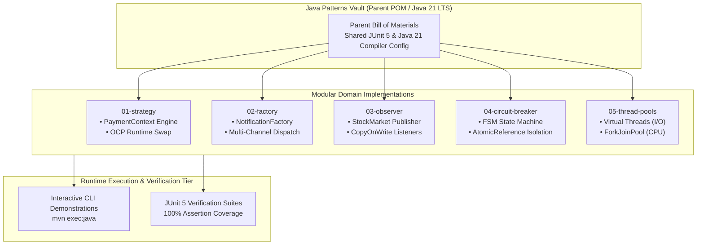

# Java Patterns Vault

[](https://adoptium.net)
[](https://maven.apache.org)
[](https://junit.org/junit5/)
[](https://github.com/i-viki/java-patterns-vault/actions)
[](LICENSE)

An enterprise-grade, **modular architectural repository of reference design patterns and Java 21 concurrency primitives**. Engineered as an isolated multi-module Maven suite, each pattern provides production-realistic domain implementations, rigorous JUnit 5 test suites, full Javadoc specifications, and modern Java features including **Virtual Threads (Project Loom)**, **sealed interfaces**, **records**, and **ForkJoinPool parallelism**.

---

## Key Architecture Pillars

- **Modular Maven Multi-Module Architecture (`pom.xml`):**
  Decoupled parent Bill of Materials (BOM) orchestrating 5 isolated pattern modules with shared Java 21 compiler targets and testing dependencies.
- **Dynamic Strategy Pattern (`01-strategy`):**
  Runtime-swappable payment processing engines (Credit Card, PayPal, Crypto) adhering strictly to the Open-Closed Principle (OCP) with immutable transaction audit logs.
- **Decoupled Factory Pattern (`02-factory`):**
  Multi-channel notification dispatchers (Email, SMS, Push) isolating concrete instantiations behind static factory abstractions and Java `Optional` return semantics.
- **High-Throughput Observer Pattern (`03-observer`):**
  Thread-safe event propagation engine modeling live stock market ticks across portfolio trackers using `CopyOnWriteArrayList` and immutable event records.
- **Fault-Tolerant Circuit Breaker (`04-circuit-breaker`):**
  Finite state machine (`CLOSED` $\leftrightarrow$ `OPEN` $\leftrightarrow$ `HALF_OPEN`) with atomic state transitions (`AtomicReference`) isolating external API dependencies from cascading failures.
- **Modern Concurrency & Workload Allocators (`05-thread-pools`):**
  Java 21 executor selection distinguishing between CPU-bound parallelism (`ForkJoinPool`) and high-concurrency I/O workloads (`Executors.newVirtualThreadPerTaskExecutor()`).

---

## System Architecture



---

## Pattern Taxonomy & Workload Model Invariants

The vault categorizes software engineering patterns into domain-specific execution semantics:

$$N_{\text{threads}}^{\text{CPU}} = N_{\text{cores}}, \quad N_{\text{threads}}^{\text{IO}} = \infty \text{ (Virtual Thread Fibers)}$$

| Module | Design Pattern | Production Problem Solved | Core Java 21 Primitives |
| :--- | :--- | :--- | :--- |
| **`01-strategy`** | Behavioral / Strategy | Eliminates fragile `if-else` branching in billing | Interfaces, Polymorphism, Records |
| **`02-factory`** | Creational / Factory | Decouples notification dispatch from callers | Static Factories, Enums, `Optional<T>` |
| **`03-observer`** | Behavioral / Observer | Thread-safe pub/sub broadcast for financial tickers | `CopyOnWriteArrayList`, Immutable Records |
| **`04-circuit-breaker`**| Resilience / FSM | Prevents cascading gateway outages during downstream failure | `AtomicReference`, CAS, State Pattern |
| **`05-thread-pools`** | Concurrency / Executor | Optimal throughput matching hardware constraints | Virtual Threads, `ForkJoinPool`, `ScheduledExecutor` |

---

## Quickstart & Platform Orchestration

### Prerequisites
- Java 21 LTS (Oracle OpenJDK or Eclipse Temurin)
- Apache Maven 3.9+

---

### Option A: Build and Run All Test Suites (Recommended)

Compile all modules and execute the automated verification test suite:
```bash
# Clone repository
git clone https://github.com/i-viki/java-patterns-vault.git
cd java-patterns-vault

# Compile parent BOM and sub-modules
mvn clean compile

# Execute all JUnit 5 test suites
mvn test
```

---

### Option B: Interactive Pattern Demonstrations

Execute live standalone pattern demonstrations directly from the CLI:

#### Strategy Pattern Demo
```bash
mvn -pl 01-strategy exec:java -Dexec.mainClass=dev.jayav.patterns.strategy.StrategyDemo
```

#### Factory Pattern Demo
```bash
mvn -pl 02-factory exec:java -Dexec.mainClass=dev.jayav.patterns.factory.FactoryDemo
```

#### Observer Pattern Demo
```bash
mvn -pl 03-observer exec:java -Dexec.mainClass=dev.jayav.patterns.observer.ObserverDemo
```

#### Circuit Breaker Pattern Demo
```bash
mvn -pl 04-circuit-breaker exec:java -Dexec.mainClass=dev.jayav.patterns.circuitbreaker.CircuitBreakerDemo
```

#### Thread Pools Concurrency Demo
```bash
mvn -pl 05-thread-pools exec:java -Dexec.mainClass=dev.jayav.patterns.threadpool.ThreadPoolDemo
```

---

## Decoupled Module Strategy

The repository isolates dependencies and execution scopes across Maven sub-modules:

| Module Directory | Artifact ID | Primary Execution Class | Scope |
| :--- | :--- | :--- | :--- |
| **`01-strategy`** | `pattern-strategy` | `dev.jayav.patterns.strategy.StrategyDemo` | Payment engine swapping & audit trail |
| **`02-factory`** | `pattern-factory` | `dev.jayav.patterns.factory.FactoryDemo` | Multi-channel notification delivery |
| **`03-observer`** | `pattern-observer` | `dev.jayav.patterns.observer.ObserverDemo` | Stock market ticker broadcast |
| **`04-circuit-breaker`**| `pattern-circuit-breaker` | `dev.jayav.patterns.circuitbreaker.CircuitBreakerDemo`| Microservice fault isolation FSM |
| **`05-thread-pools`** | `pattern-thread-pools` | `dev.jayav.patterns.threadpool.ThreadPoolDemo` | Virtual Threads vs ForkJoinPool benchmarking |

---

## Live Telemetry & Observability Hubs

| Hub / Service | Type | Target | Role & Live Features |
| :--- | :--- | :--- | :--- |
| **GitHub Actions CI** | CI Pipeline | [.github/workflows/ci.yml](.github/workflows/ci.yml) | Continuous automated build and JUnit 5 regression test validation. |
| **Javadoc Portal** | Documentation | `mvn javadoc:aggregate` | Comprehensive aggregated API and design pattern documentation. |

---

## Testing & Quality Assurance Suite

### Multi-Module JUnit 5 Regression Suite
```bash
mvn test
# Executes all test suites across all 5 modules, asserting zero race conditions and state compliance.
```

### Module-Specific Targeted Test
```bash
mvn -pl 04-circuit-breaker test
# Validates atomic state transitions: CLOSED -> OPEN -> HALF_OPEN -> CLOSED.
```

---

## Author

**Jayavignesh**
- **Website:** [jayavignesh.dev](https://jayavignesh.dev)
- **GitHub:** [@i-viki](https://github.com/i-viki)
- **Email:** [hello@jayavignesh.dev](mailto:hello@jayavignesh.dev)

---

## License

This platform is distributed under the **MIT License**. See the [`LICENSE`](LICENSE) file for complete terms.
